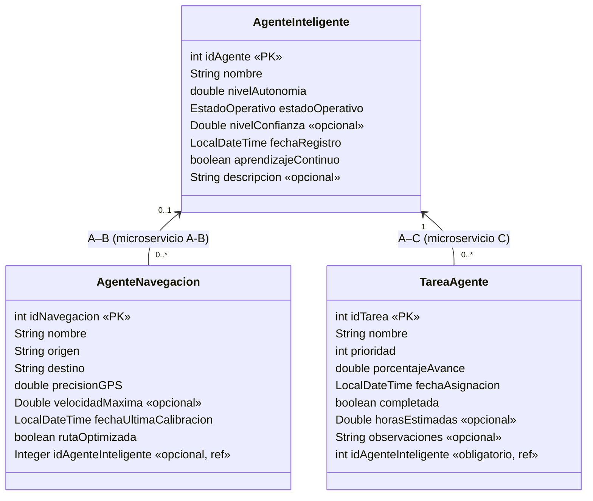

# Sistema de Agentes Inteligentes — Tercer proyecto 2026B

Desarrollo de Aplicaciones Empresariales · Universidad de Ibagué · **Versión 4.0.0**

**Integrantes:** Stephany Trujillo Murillo · Juan Camilo Acuña · Luis Hernandez

Aplicación web distribuida con **dos microservicios Java** (cada uno con su propia base de datos **MongoDB**,
NO relacional) y **dos clientes gráficos en lenguajes diferentes al servidor**: uno de escritorio (Python) y uno
web (JavaScript/React).

| Componente | Tecnología | Servicio web | Base de datos | Puerto |
|---|---|---|---|---|
| `Servidor/ServidorAgentes` — **Microservicio A‑B** | Java 17 · Spring Boot 3 · Spring for GraphQL · Spring Data MongoDB | **GraphQL** | `agentes_inteligentes_db` (colecciones `agentes_inteligentes` y `agentes_navegacion`) | 8081 |
| `Servidor/ServicioTareas` — **Microservicio C** | Java 17 · Spring Boot 3 · Spring Web · Spring Data MongoDB | **REST** | `tareas_agentes_db` (colección `tareas_agentes`) | 8082 |
| `Cliente-Escritorio-Python` | Python 3 · Tkinter · requests | Consume GraphQL de A‑B | — | — |
| `Cliente-Web-React` | JavaScript · React 18 · Vite | Consume GraphQL de A‑B | — | 5173 |

## 1. Arquitectura (explicación sencilla)

```
 Cliente Python (Tkinter) ─┐                        ┌──────────────────────────┐      ┌──────────────────────┐
                           ├── GraphQL (8081) ────► │ Microservicio A-B (Java) │ ───► │ MongoDB              │
 Cliente Web (React)  ─────┘                        │  Agentes inteligentes (A)│      │ agentes_inteligentes_db│
                                                    │  Agentes navegación  (B) │      └──────────────────────┘
                                                    │  Tareas (C) ── REST ─────┼──┐
                                                    └──────────────────────────┘  │
                                                    ┌──────────────────────────┐  │   ┌──────────────────────┐
                                                    │ Microservicio C (Java)   │ ◄┘   │ MongoDB              │
                                                    │  Tareas de los agentes   │ ───► │ tareas_agentes_db    │
                                                    └──────────────────────────┘      └──────────────────────┘
```

1. Los clientes **solo conocen el microservicio A‑B**. Todas las operaciones (también las de tareas) se piden por GraphQL a `http://localhost:8081/graphql`.
2. Cuando la operación es de una **tarea (clase C)**, el microservicio A‑B:
   - revisa en **su** base de datos que el agente inteligente exista (integridad referencial), y
   - llama al **microservicio C** por REST (`ClienteMicroservicioTareas`, con `RestTemplate`).
3. El microservicio C valida y guarda la tarea en **su propia base de datos** y responde. A‑B le devuelve la respuesta al cliente.

Así la comunicación entre microservicios es **transparente** para los clientes gráficos (figura 4 del enunciado).

## 2. Clases A, B y C



- **A (maestro):** `AgenteInteligente` · **B (detalle):** `AgenteNavegacion` · **C:** `TareaAgente` (tarea asignada a un agente inteligente; relación A 1 — 0..* C, como en la figura 2).
- En MongoDB no hay llaves foráneas: la relación se guarda como **referencia** (`idAgenteInteligente`) en el documento hijo.

### Atributos de la clase C (TareaAgente)

| Atributo | Tipo | Obligatorio | Validación |
|---|---|---|---|
| idTarea | int | Sí (llave primaria) | Entero positivo, no repetido |
| nombre | String | Sí | 3–50 caracteres, letras/números/espacio/`.`/`-`/`_`, único |
| prioridad | int | Sí | 1 a 5 |
| porcentajeAvance | double | Sí | 0 a 100 |
| fechaAsignacion | LocalDateTime | Sí | No puede ser futura |
| completada | boolean | Sí | Si está completada, el avance debe ser 100 % |
| horasEstimadas | Double | No | Mayor que 0 y hasta 1000 |
| observaciones | String | No | Máximo 200 caracteres |
| idAgenteInteligente | int | Sí | El agente inteligente **debe existir** |

Las validaciones de A y B se mantienen como en el prototipo (ver `modelo/campos` en los clientes y los `dto/*Input` del servidor).
Todas se revisan **en el cliente** (para avisar antes de enviar) y **en el servidor** (Bean Validation + reglas de negocio).

### Integridad referencial A ↔ C

| Situación | Qué pasa |
|---|---|
| Insertar o actualizar una tarea con un agente que no existe | A‑B la rechaza **antes** de llamar al microservicio C: *"No existe el agente inteligente con ID…"* |
| Eliminar un agente inteligente que tiene tareas | A‑B pregunta a C cuántas tareas tiene (`/api/tareas/contar`). Si tiene, **no deja eliminarlo**: *"…tiene N tarea(s) asignada(s)…"* |
| Eliminar un agente sin tareas | Se elimina normalmente (sus agentes de navegación quedan sin agente, como antes) |
| El microservicio C está apagado | Las operaciones de tareas y la eliminación de agentes muestran un mensaje claro y no se hace nada a medias |

## 3. Servicios web

### Microservicio A‑B — GraphQL (`http://localhost:8081/graphql`, pruebas en `/graphiql`)

| Caso de uso | Agente inteligente (A) | Agente de navegación (B) | Tarea (C) |
|---|---|---|---|
| Insertar | `crearAgenteInteligente` | `crearAgenteNavegacion` | `crearTareaAgente` |
| Consultar uno (por ID o nombre) | `agenteInteligentePorId` / `…PorNombre` | `agenteNavegacionPorId` / `…PorNombre` | `tareaAgentePorId` / `tareaAgentePorNombre` |
| Listar todos + filtro | `agentesInteligentesResumen(estado)` | `navegacionesConAgente(destino)` / `navegacionesPorAgente(idAgente)` | `tareasConAgente(idAgente, prioridad)` |
| Actualizar | `actualizarAgenteInteligente` | `actualizarAgenteNavegacion` | `actualizarTareaAgente` |
| Eliminar | `eliminarAgenteInteligente` | `eliminarAgenteNavegacion` | `eliminarTareaAgente` |

`tareasConAgente` devuelve **todos los atributos de la tarea + 2 atributos del agente inteligente** (`nombreAgente` y `estadoAgente`).
Ejemplos listos para copiar en `Servidor/ServidorAgentes/consultas-ejemplo.graphql`.

### Microservicio C — REST (`http://localhost:8082/api/tareas`)

Solo lo usa el microservicio A‑B.

| Método | Ruta | Para qué |
|---|---|---|
| POST | `/api/tareas` | Insertar |
| GET | `/api/tareas/{idTarea}` | Buscar por ID |
| GET | `/api/tareas/buscar?nombre=…` | Buscar por nombre |
| GET | `/api/tareas?idAgente=&prioridad=&pagina=0&tamano=25` | Listar (filtros opcionales) |
| PUT | `/api/tareas/{idTarea}` | Actualizar |
| DELETE | `/api/tareas/{idTarea}` | Eliminar |
| GET | `/api/tareas/contar?idAgente=…` | Cantidad de tareas de un agente (integridad referencial) |

Los errores se responden como `{"mensaje": "..."}` con código 400 o 404.

## 4. Instalación de dependencias

| Necesario para | Programa |
|---|---|
| Microservicios | **JDK 17 o superior** y **Maven 3.9+** (o abrir los proyectos en IntelliJ IDEA / NetBeans, que traen Maven) |
| Bases de datos | **MongoDB Community Server 7** (o Docker Desktop) · opcional: MongoDB Compass para ver los datos |
| Cliente de escritorio | **Python 3.10+** con Tkinter (en Windows viene incluido; en Ubuntu: `sudo apt install python3-tk`) |
| Cliente web | **Node.js 18+** (incluye npm) |

Las dependencias Java se descargan solas la primera vez que se compila (están en cada `pom.xml`).

## 5. Configuración de las bases de datos

**Opción A — Docker:** en la raíz del proyecto ejecutar `docker compose up -d`.

**Opción B — MongoDB instalado:** dejar el servicio de MongoDB corriendo en `localhost:27017`.

No hay que crear nada a mano: al arrancar, cada microservicio crea **su** base de datos, sus colecciones e índices,
y carga datos de prueba si están vacías:

- A‑B → `agentes_inteligentes_db`: 3 agentes inteligentes (Atlas, Boreas, Cronos) y 4 agentes de navegación.
- C → `tareas_agentes_db`: 4 tareas (2 de Atlas y 2 de Boreas). **Cronos queda sin tareas** para mostrar en clase que ese sí se puede eliminar y Atlas no.

Si MongoDB está en otro equipo, se cambia `spring.data.mongodb.uri` en el `application.properties` de cada microservicio.

## 6. Cómo ejecutar (en este orden)

**0. MongoDB** encendido (paso anterior).

**1. Microservicio C (tareas)** — puerto 8082
```
cd Servidor/ServicioTareas
mvn spring-boot:run
```
(o abrir la carpeta en el IDE y ejecutar `ServicioTareasApplication`). Prueba rápida: abrir http://localhost:8082/api/tareas

**2. Microservicio A‑B (agentes)** — puerto 8081
```
cd Servidor/ServidorAgentes
mvn spring-boot:run
```
(o ejecutar `ServidorAgentesApplication`). Pruebas en http://localhost:8081/graphiql.
La URL del microservicio C está en `application.properties`: `microservicio.tareas.url=http://localhost:8082/api/tareas`.

**3. Cliente de escritorio (Python)**
```
cd Cliente-Escritorio-Python
pip install -r requirements.txt
python main.py
```

**4. Cliente web (React)**
```
cd Cliente-Web-React
npm install
npm run dev        # abrir http://localhost:5173
```

Si el servidor está en otro equipo de la red: en escritorio, variable de entorno `GRAPHQL_URL=http://IP:8081/graphql`;
en web, crear `.env` con `VITE_GRAPHQL_URL=http://IP:8081/graphql`.

## 7. Funcionalidades implementadas

En **los dos clientes**, para **las tres clases** (menús *Agentes inteligentes*, *Agentes de navegación* y *Tareas*):

- **Ventana principal** con menú de navegación y **Ayuda → Acerca de…** (integrantes y versión 4.0.0).
- **Adicionar:** formulario con validación de cada atributo; el agente se elige escribiendo su nombre o ID.
- **Consultar:** UN solo objeto por un parámetro (ID o nombre) mostrando todos sus atributos.
- **Listar:** grilla paginada con todos los registros y filtro por un parámetro.
  Tareas: filtro por *agente inteligente* o por *prioridad*; la grilla muestra la tarea + **nombre y estado del agente**.
- **Actualizar:** búsqueda previa, se muestra TODA la información actual, se modifican uno o varios atributos y se confirma.
- **Eliminar:** búsqueda previa, se muestra TODA la información y se pide confirmación.
- Cada ventana implementa **un solo caso de uso**. Los errores del servidor se muestran con mensajes claros.
- Si una ventana de *Listar* está abierta y se agrega, modifica o elimina un registro en otra ventana, la grilla se actualiza sola.

## 8. Requisitos de la rúbrica

| Criterio | Cómo se cumple |
|---|---|
| **Arquitectura** (requerimiento) | Servidor: paquetes `model` (clases estructurales `AgenteInteligente`, `AgenteNavegacion`, `TareaAgente`), `controller`, `servicios`, `repository`, `dto`. Microservicio C con sus propios `model/TareaAgente`, `controller`, `servicios`, `repository`. Clientes: `modelo` (clases estructurales, incluida `tarea_agente.py` / `TareaAgente.js`), `servicios` y `vistas` (GUI; en Python, paquete `vistas/tarea_agente/` con una ventana por caso de uso) |
| **Implementación de PD** (requerimiento) | GraphQL en el microservicio A‑B; REST en el microservicio C. Clientes en Python y JavaScript (el servidor es Java). Persistencia en MongoDB, una base por microservicio |
| **Insertar C** (20 %) | Ventana *Tareas → Adicionar*. Integridad referencial: el agente debe existir (validado en A‑B antes de llamar a C) |
| **Eliminar C** (20 %) | *Tareas → Eliminar*: buscar, ver TODA la información, confirmar. Se borra en `tareas_agentes_db` |
| **Listar C con parámetro** (20 %) | *Tareas → Listar*: grilla con todos los atributos de la tarea **+ nombre y estado del agente (2 atributos de A)**; filtro por agente o por prioridad |
| **Actualizar C** (20 %) | *Tareas → Actualizar*: buscar, ver TODA la información actual, cambiar uno o varios atributos, confirmar |
| **Consulta C con parámetro** (20 %) | *Tareas → Consultar*: un solo objeto por ID o por nombre con todos sus atributos |

**Sobre "el uso de una lista está prohibido":** se interpreta como en la retroalimentación del segundo proyecto:
la información **no** se guarda en listas en memoria (`ArrayList` como "base de datos"). Toda la información vive en
MongoDB y cada consulta se hace a la base de datos. Las listas que aparecen en el código son solo la página de
resultados que viaja hacia la grilla (máximo 100 registros), no el almacenamiento.

## 9. Estructura del proyecto

```
Servidor/
├── ServidorAgentes/  (Microservicio A-B, GraphQL)  src/main/java/com/unibague/agentes/
│   ├── model/        AgenteInteligente, AgenteNavegacion, EstadoOperativo, TareaAgente
│   ├── dto/          Inputs con validación, AgenteResumen, NavegacionConAgente, TareaConAgente, Pagina
│   ├── repository/   Repositorios Spring Data MongoDB
│   ├── servicios/    Reglas de negocio + ClienteMicroservicioTareas (llamadas REST al microservicio C)
│   ├── controller/   AgenteInteligenteController, AgenteNavegacionController, TareaAgenteController
│   ├── config/       Escalar DateTime, datos iniciales
│   └── excepciones/  Excepciones propias + mensajes claros al cliente
└── ServicioTareas/   (Microservicio C, REST)  src/main/java/com/unibague/tareas/
    ├── model/        TareaAgente (documento de la colección tareas_agentes)
    ├── repository/   TareaAgenteRepository
    ├── servicios/    ServicioTareaAgente (reglas de negocio)
    ├── controller/   TareaAgenteController (@RestController /api/tareas)
    ├── dto/          Pagina
    ├── config/       Datos iniciales
    └── excepciones/  Excepciones + ManejadorErrores ({"mensaje": ...})

Cliente-Escritorio-Python/
├── modelo/       agente_inteligente, agente_navegacion, tarea_agente, campos, validador, formato
├── servicios/    cliente_graphql, notificador + un servicio por clase
└── vistas/       ventana_principal, acerca_de, casos_base, componentes
    ├── agente_inteligente/   una ventana por caso de uso
    ├── agente_navegacion/    una ventana por caso de uso
    └── tarea_agente/         una ventana por caso de uso

Cliente-Web-React/src/
├── modelo/       AgenteInteligente, AgenteNavegacion, TareaAgente, campos, validador, formato
├── servicios/    clienteGraphQL, notificador + un servicio por clase
├── config/       entidades (qué campos, columnas y filtros tiene cada clase), app
├── componentes/  MenuPrincipal, Ventana, Formulario, Ficha, Grilla, Buscador, Aviso, AcercaDe
└── vistas/       Inicio + una vista por caso de uso
```

## 10. Qué cambió respecto al tercer prototipo

- Nueva clase C **`TareaAgente`** y nuevo **microservicio `ServicioTareas`** (REST + base `tareas_agentes_db`).
- El microservicio A‑B ahora expone las operaciones de tareas por GraphQL y llama al microservicio C por dentro.
- Integridad referencial A ↔ C (validación al insertar/actualizar tareas y bloqueo al eliminar agentes con tareas).
- Menú **Tareas** con sus 5 ventanas en los dos clientes.
- *Acerca de…* con los tres integrantes y versión 4.0.0.

## 11. Patrones y decisiones que vienen del prototipo

| Patrón | Dónde | Para qué |
|---|---|---|
| MVC | Servidor y clientes (`model`/`modelo`, `controller`/`vistas`, `servicios`) | Separar datos, interfaz y lógica |
| Repository | `*Repository` (Spring Data MongoDB) | Aislar el acceso a la base de datos |
| DTO | `dto/*Input`, `TareaConAgente`, `Pagina` | Datos de entrada validados y resultados combinados |
| Singleton | `ClienteGraphQL` y `Notificador` en los clientes | Una sola conexión y un solo canal de avisos |
| Observer | `Notificador` + ventanas de Listar | La grilla se refresca sola cuando cambian los datos |
| Template Method | `vistas/casos_base.py` (escritorio) | Cada caso de uso tiene una ventana base; las de cada clase solo indican campos, servicio y columnas |

Los listados son **paginados** (25 filas por defecto, máximo 100). Para demostrarlo con miles de registros:
en `ServidorAgentes/src/main/resources/application.properties` poner `datos.prueba.masivos=5000` y reiniciar.

## 12. Subir el proyecto a GitHub

1. Crear un repositorio vacío en GitHub (botón **New**), por ejemplo `SistemaAgentesInteligentes-Proyecto3`, sin README.
2. En la carpeta raíz del proyecto:
   ```
   git init
   git add .
   git commit -m "Tercer proyecto 2026B: microservicio de tareas (clase C)"
   git branch -M main
   git remote add origin https://github.com/USUARIO/SistemaAgentesInteligentes-Proyecto3.git
   git push -u origin main
   ```
3. El archivo `.gitignore` ya evita subir `target/`, `node_modules/`, `dist/` y `__pycache__/`.
4. Agregar a los compañeros en **Settings → Collaborators** y entregar el enlace del repositorio en la plataforma.
